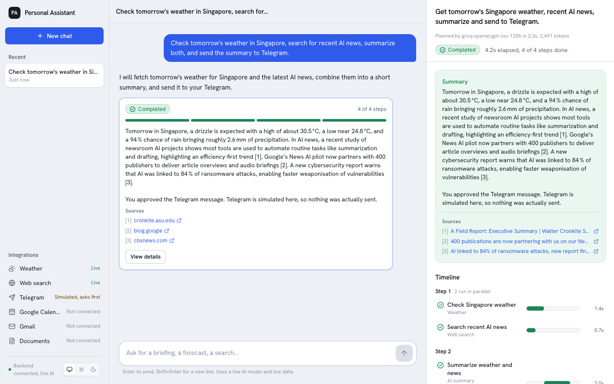
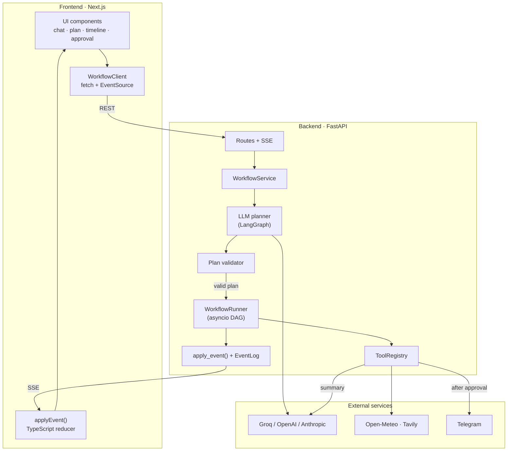
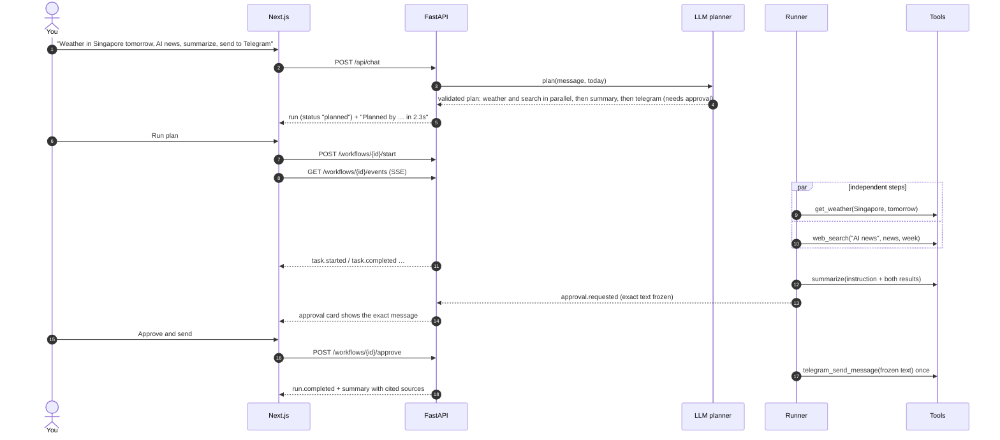
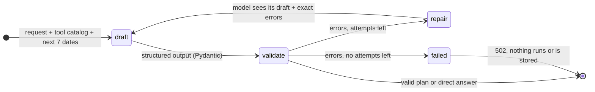
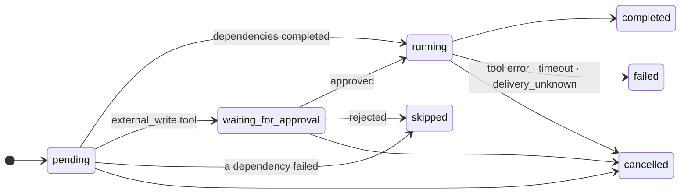
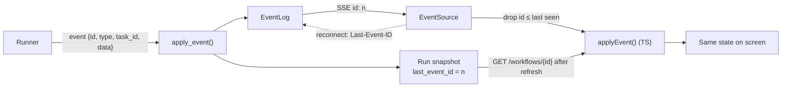

# Personal AI Assistant

A full-stack AI assistant that **plans before it acts**. You ask in plain language. An LLM drafts a plan, the backend validates it, independent steps run in parallel with live progress in the browser, and nothing is sent anywhere until you approve the exact message.

> "Check tomorrow's weather in Singapore, search for recent AI news, summarize both, and send the summary to Telegram."



**Stack:** Next.js 16, React 19, TypeScript and Tailwind CSS 4 · FastAPI and Pydantic · LangGraph and LangChain (Groq, OpenAI or Anthropic) · Server-Sent Events · Open-Meteo, Tavily and the Telegram Bot API · pytest, Vitest and Playwright

| Milestone | Status |
| --- | --- |
| 1. Backend foundation: FastAPI, tool registry, LLM tool calling | ✅ |
| 2. Frontend: chat, plan view, live timeline, approvals (in-browser mock) | ✅ |
| 3. Frontend ↔ FastAPI: backend-owned workflows, SSE, approve/reject/cancel | ✅ |
| 4. Real LLM planning, real Weather / Web Search / Telegram | ✅ |
| Next: PostgreSQL persistence, auth, Gmail/Calendar, document RAG, Expo mobile | Planned |

## Quick start

Two terminals. The default `MOCK_MODE=true` needs **no API keys**.

```bash
# Backend: http://localhost:8000/docs
cd backend
python3.13 -m venv .venv && source .venv/bin/activate
pip install -e ".[dev]"
cp .env.example .env
uvicorn app.main:app --reload
```

```bash
# Frontend: http://localhost:3000
cd frontend
npm install
cp .env.example .env.local
npm run dev
```

**Live mode:** in `backend/.env`, set `MOCK_MODE=false`, `GROQ_API_KEY` (or another provider's key) and `WEB_SEARCH_API_KEY` (Tavily). To really send, also set `TELEGRAM_BOT_TOKEN` and `TELEGRAM_CHAT_ID`; setup steps are in [`backend/.env.example`](backend/.env.example). Weather (Open-Meteo) needs no key.

## Architecture



The key idea is that **the LLM proposes and Python decides.** The planner returns data (a JSON plan), never code. The validator checks it against the tool registry. A single executor, the `WorkflowRunner`, runs it, and every state change it makes is an event. The browser applies the same events with a TypeScript twin of the backend reducer, so the screen always matches the server.

## One request, end to end



## Planning with LangGraph



The validator rejects:
- unknown tools, invalid arguments, duplicate ids, missing dependencies and cycles
- plans with more than 8 tasks or more than 4 levels
- plans that set fields the backend fills itself
- any shape other than "data steps → one summary → optional send"

Approval requirements come from each tool's risk level, never from the LLM.

## Workflow and task states



A run is `planned → running ⇄ waiting_for_approval → completed | failed | cancelled`. A run fails if any task failed. A rejected send still lets the run complete.

## Live updates: one source of truth



`contracts/workflow-scenarios.json` is recorded from the Python runner. The frontend's tests replay it through the TypeScript reducer, so both reducers must agree on every scenario: approve, reject, cancel and failure.

## Repository layout

```
backend/              FastAPI app (see backend/README.md)
  app/llm/            provider factory + LLMClient (timeouts, usage, error mapping)
  app/providers/      HTTP clients: Open-Meteo, Tavily, Telegram
  app/tools/          registry + tools (mock and real versions under the same names)
  app/workflows/      contract, planners, validator, runner, reducer, event log, service
  tests/              153 tests, network blocked; tests/live/ is opt-in
frontend/             Next.js app (see frontend/README.md)
  src/lib/api/        contract types, WorkflowClient (HTTP + mock)
  src/lib/workflow/   reducer, graph helpers, metrics
  src/components/     chat, workflow panel, approvals, layout
  e2e/                Playwright, run against mock and HTTP modes
contracts/            event streams recorded by the backend, replayed by the frontend
```

## Safety model

| Risk | Control |
| --- | --- |
| The LLM runs something unexpected | It only returns a plan. Tools come from an allow-list, and arguments are validated when planning and again when executing |
| The LLM skips approval or picks the recipient | Approval comes from the tool's risk level. The Telegram chat is fixed by `TELEGRAM_CHAT_ID`, and the tool's input is only `text` |
| You approve one thing and another is sent | Arguments are frozen when the approval is created. The runner re-checks the approval right before running |
| Duplicate messages | One start per task, 409 on a second approve, no automatic retries, and `delivery_unknown` when Telegram doesn't confirm |
| Prompt injection from web pages | Results are passed fenced as untrusted data. The summarizer has no tools, and citations must match real result URLs |
| Leaked secrets | Keys stay server-side, provider errors are mapped to safe messages, and the httpx URL log is silenced (Telegram's URL contains the token) |

## Testing

| Suite | Command | Covers |
| --- | --- | --- |
| Backend | `cd backend && pytest` | 153 tests: planner and validator, runner concurrency, approvals, Telegram, SSE, providers (mocked HTTP), full live-mode API with a scripted LLM |
| Frontend unit | `cd frontend && npm test` | 54 tests: reducer contract with the backend, HTTP client, state, metrics |
| Browser | `cd frontend && npm run test:e2e` | 23 Playwright tests, mock and HTTP modes, desktop and mobile |
| Live (optional) | `LIVE_TESTS=1 pytest -m live` | Real Open-Meteo, Tavily and LLM. Real Telegram only with `LIVE_TELEGRAM=1` |

## Known limitations

- **State is in memory and needs a single worker.** A restart forgets everything, and multiple uvicorn workers can't share runs. PostgreSQL is next.
- **"Today" is the server's local date.** A hosted version should use the browser's time zone.
- **No authentication or rate limiting yet.**
- **Plans have a fixed shape** (data steps → summary → optional send). Chained data steps would need more binding rules.

More detail: [backend/README.md](backend/README.md) · [frontend/README.md](frontend/README.md) · [backend/tests/live/README.md](backend/tests/live/README.md)
