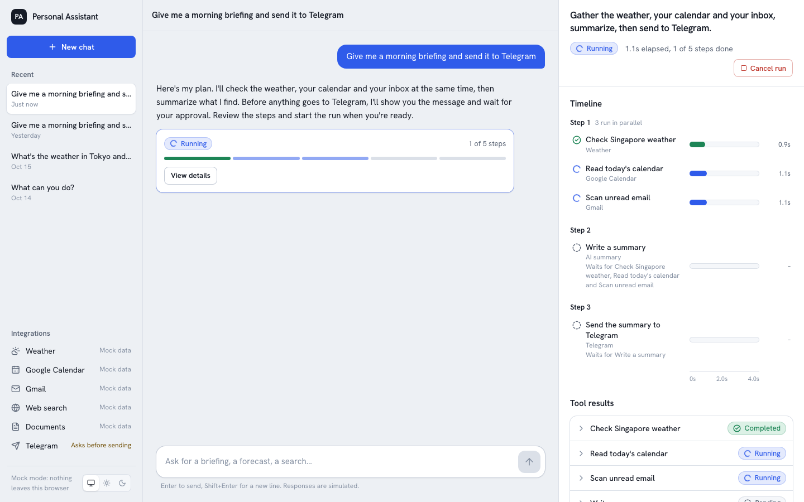
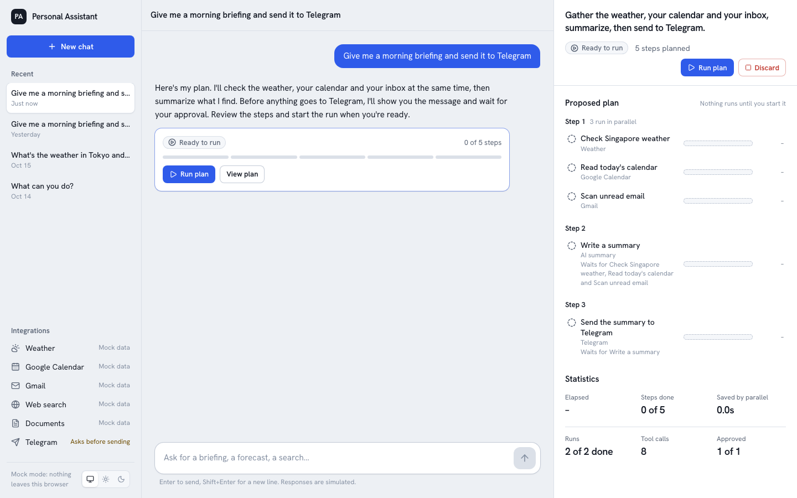
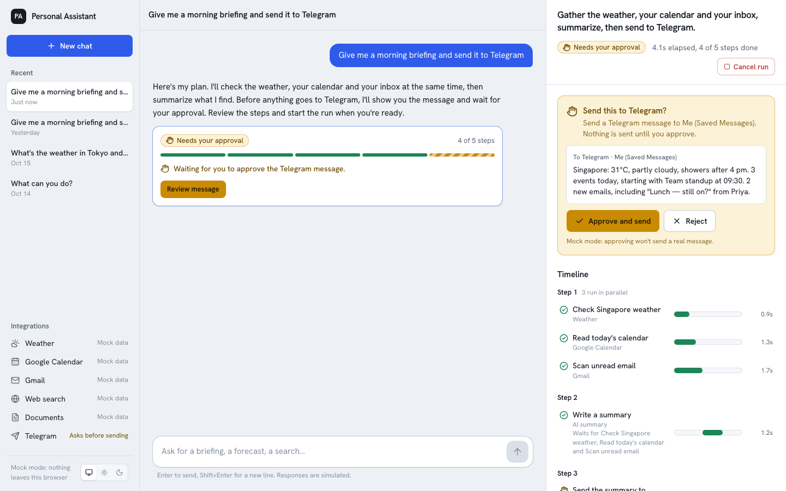
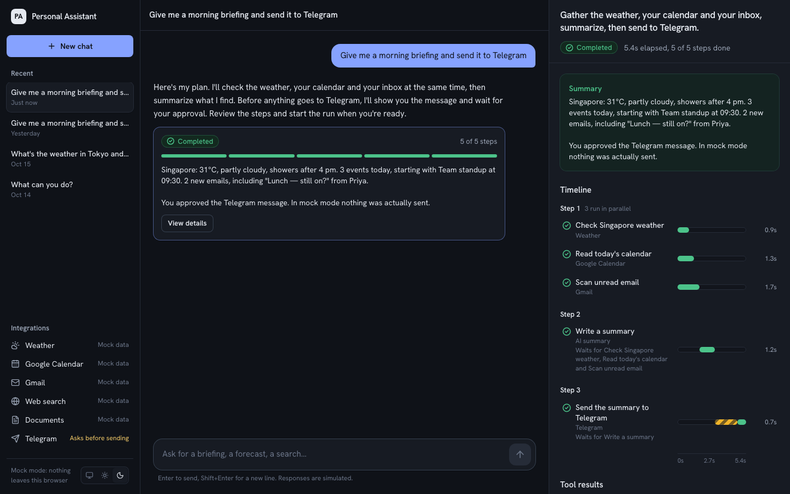
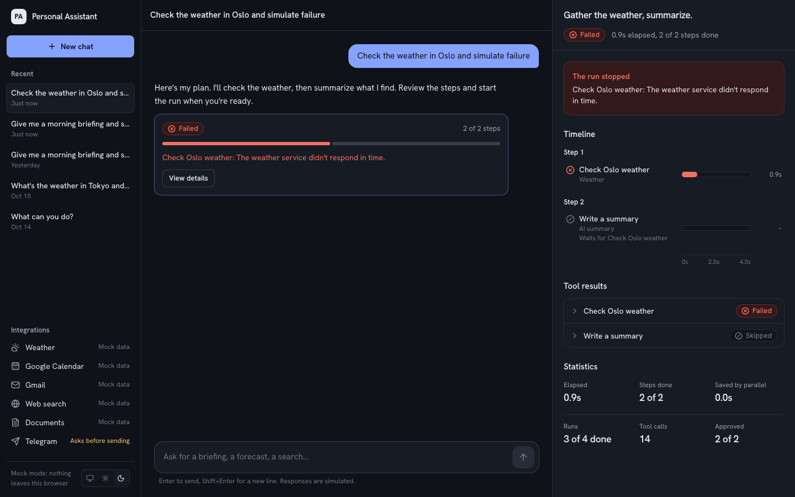

# Frontend: Personal Assistant

Next.js 16 + TypeScript + Tailwind CSS 4. It has two interchangeable backends:

- **HTTP mode**: the FastAPI server in `../backend` runs the workflows and streams progress over SSE.
- **Demo mode**: the same behavior simulated in the browser, so you need no backend.

In both modes all tools are mocked: no LLM calls, no external services, and nothing is sent anywhere.



## Run it

Requires Node 20.9 or newer.

```bash
cd frontend
npm install
cp .env.example .env.local     # HTTP mode; start the backend too (see ../backend/README.md)
npm run dev                    # http://localhost:3000
```

For demo mode without a backend, set `NEXT_PUBLIC_API_MODE=mock` in `.env.local` (or delete the file). Restart `npm run dev` after changing it.

| Command | What it does |
| --- | --- |
| `npm test` | Unit tests (Vitest): engine, graph, planner, both clients, state, contract with the backend |
| `npm run test:e2e` | Browser tests (Playwright). Starts FastAPI and two production builds, then runs the UI suite in both modes on desktop and Pixel 7. First run: `npx playwright install chromium` |
| `npm run build` | Production build |
| `npm run typecheck` / `npm run lint` | Static checks |

### Try these
- **"Give me a morning briefing and send it to Telegram"**: three tasks in parallel, a summary, then an approval request.
- **"…and simulate failure"**: the first task fails and its dependants are skipped.
- **"simulate error"**: the chat request fails (503), with a retry option.
- **Refresh mid-run** (HTTP mode): the open conversation is in the URL (`?c=…`), so the run is reloaded from the server and the stream resumes.
- Demo mode only: append `?mock_speed=3` to slow every task down 3×.

## Architecture

```
src/
  lib/api/types.ts        API contract (snake_case JSON); mirrors backend/app/workflows/models.py
  lib/api/client.ts       WorkflowClient interface: the only thing the UI calls
  lib/api/http-client.ts  HttpWorkflowClient: fetch + EventSource against FastAPI
  lib/api/mock/           MockWorkflowClient + in-browser engine, planner, tools, seed data
  lib/api/index.ts        createWorkflowClient(): picks a client from NEXT_PUBLIC_API_MODE
  lib/workflow/           pure logic: reducer (applyEvent), graph, metrics
  lib/state/              app state reducer (no effects)
  hooks/use-assistant.ts  effects: loading, sending, one event stream per live run
  components/             rendering only; never imports from lib/api/mock
```

**Events are the source of truth.** The run panel is the result of applying `WorkflowEvent`s with `applyEvent()`. In HTTP mode the server streams them. In demo mode the in-browser engine produces identical ones. `tests/unit/contract.test.ts` replays streams recorded from the Python runner (`../contracts/workflow-scenarios.json`) and checks the result equals the backend's own snapshot, so the two reducers can't drift apart.

**Streaming and recovery** (HTTP mode):
- The hook opens one SSE stream per unfinished run, starting after the snapshot's `last_event_id`.
- If the connection drops, the panel says "Reconnecting". `EventSource` retries, and the server resumes from `Last-Event-ID`. Duplicate events are dropped by id.
- Snapshots returned by **Run plan** and **Cancel** are applied immediately, so the UI stays correct even while the stream is down.
- If the server is unreachable, requests fail with a clear message, and sending offers "Send again".

## API contract

Routes, event types and execution rules are documented in [`../backend/README.md`](../backend/README.md#api). The TypeScript shapes are in [`src/lib/api/types.ts`](src/lib/api/types.ts).

## What Milestone 4 changes here

Little to nothing. Real tools and an LLM planner run on the server and emit the same events. Expect only new tool names in `ToolName` and `TOOL_LABELS`, and richer `output` shapes in the results panel. The demo mode can stay as an offline demo or be removed; nothing outside `lib/api/mock/` depends on it.

## Screenshots

| | |
| --- | --- |
|  |  |
|  |  |

Mobile: [chat](docs/screenshots/mobile-2-chat-approval.png) · [run sheet](docs/screenshots/mobile-3-sheet-approval.png) · [drawer](docs/screenshots/mobile-4-drawer.png)
